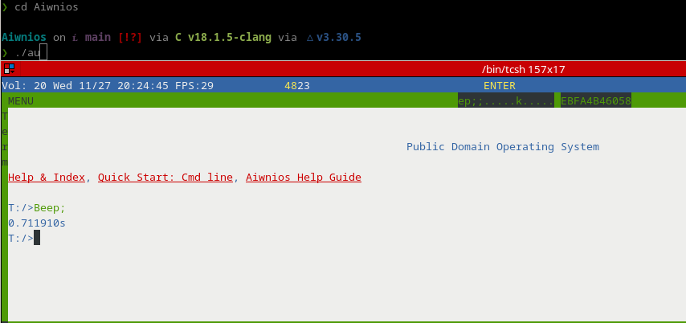

# Welcome to Tinkwanios a TinkerOS fork of Aiwnios

This is a HolyC Compiler/Runtime written for 64-bit x86_64 and aarch64 machines.

## About this fork

Tinkwanios is [Aiwnios](https://github.com/nrootconauto/aiwnios) with the work
[TinkerOS](https://github.com/Tinkeros/TinkerOS) did to extend TempleOS:

- **TempleOS 640x480x16 colors by default** Fully backwards compatible TempleOS
  API and HolyC, you can use different resolutions, scales, more colors, sounds,
  and HolyC extensions, but only if you choose to! Default TempleOS apps run just
  like they normally would on TempleOS!
- **Native bitfield members.** A `:width` on a class member is real: plain `.`
  and `->` read and write just those bits, and consecutive same-sized
  bitfields outside a union pack into one storage slot the way C does.
  `Demo/Bitfield.HC` is TinkerOS's own test suite for it.
- **`firstsize`**, a second compile-time default-argument keyword beside
  TempleOS's `lastclass`: it resolves to `sizeof()` the first argument's
  class, which is what makes `ClassCpy(&dst,&src)` need no `sizeof`.
  See `Demo/FirstSize.HC`.
- **230 colors (if you want)** A pixel was always a byte here; three places
  emulated planar VGA's 4-bit truncation anyway. The extended palette is the
  16 CGA colors plus the 214 web-safe cube entries not already among them.
  See `Demo/Graphics/TinkerOS`.
- TinkerOS's software OPL2 FM synthesizer with General MIDI instruments.
  Press `CTRL-ALT-m` to bring up the mixer and change things up if you like!
- Includes extra Apps/Demos/Emulators/Games from TinkerOS
- Includes DOOM port TOOM with glowing glowies! `/Community/Toom`
- **TinkerOS's and TempleOS's demos**, over 200 of them, under `Demo/`,
  and `Misc/OSTestSuite.HC` to run the lot and report on each one.

This fork has better TempleOS compatibility, run the test suite to prove it!

```
#include "/Misc/OSTestSuite";
```

## Support table

| Architecture | OS |
|--|--|
| x86_64 | Windows, Linux and FreeBSD |
| aarch64 | Linux, FreeBSD |

## Screenshot
<p align="center">
  <a href="https://tinkeros.github.io">
  </a>
</p>

## Building Tinkwanios

### FreeBSD/Linux/Windows

To build Tinkwanios, you will need a C compiler, SDL2 development libraries and headers, and cmake.

Build with the following after cloning:

```sh
# Build tinkwanios
mkdir build;cd build;
cmake ..;
make -j$(nproc);
cd ..;

#Bootstrap the HCRT2.BIN to run it
./tinkwanios -b;

#Run the HCRT2.BIN
./tinkwanios; # Use -g or --grab-focus to grab the keyboard, -h for more options
```

### Windows 11 Quickstart

1. Clone Tinkwanios into the location of your choice
2. Download statically compiled `tinkwanios.exe` and compiled HolyC runtime components `HCRT2.BIN/HCRT2.DBG.Z` and place them in the Tinkwanios folder.
3. Run `tinkwanios.exe`
4. Optionally set .HC files to open with `tinkwanios.exe` by default (note the will need to be located in a subdirectory of the Tinkwanios folder in order for the virtual filesystem T: drive to find them!)

### Windows 10/11 Build

1. Install [msys2](https://msys2.org)
2. Run "MSYS2 MINGW64" (***MUST*** BE MINGW64)
3. `pacman -Sy git mingw-w64-x86_64-{gcc,SDL2,cmake}`
4. Clone this repository
5. Run the following after navigating to the directory
```
mkdir build
cd build
cmake ..
ninja
cd ..
```
5. You will see the `tinkwanios` binary in the directory

### Windows 7

1. Download [WinLibs](https://winlibs.com/) and add to PATH: Make sure the mingw32/bin or mingw64/bin folder from the extracted download is in your PATH and its location doesn't contain any spaces
2. Download and extract devel mingw [SDL2](https://github.com/libsdl-org/SDL/releases)
3. Clone this repository and navigate to it
```
mkdir build
cd build
cmake -DSDL2_DIR=C:\Path\To\SDL2-devel-2.32.0-mingw\SDL2-2.32.0\x86_64-w64-mingw32\lib\cmake\SDL2 ..
ninja
cd ..
```
4. You will see the `tinkwanios` binary in the directory

### MacOS

MacOS is completely unsupported, you are on your own.

# Opening a file from the command line

Any argument that is not an option is a file to open at boot, and it may go
anywhere on the command line. The extension decides what happens to it:

| argument | what runs |
|---|---|
| `.HC`, `.HC.Z` | `#include "<file>";` |
| `.DD`, `.DD.Z` | `Ed("<file>");` |
| anything else | `#include "<file>";`, as it always did |

The path may be a **host** path. HolyC only ever sees the boot drive, so the
argument is rewritten relative to it -- with Tinkwanios installed in
`/home/ubuntu/github/Aiwnios`:

```sh
./tinkwanios /home/ubuntu/github/Aiwnios/Demo/FirstSize.HC  # #include "/Demo/FirstSize.HC";
./tinkwanios Demo/FirstSize.HC                              # the same file
./tinkwanios --scale 2 ~/github/Aiwnios/Doc/Welcome.DD -g   # Ed("/Doc/Welcome.DD");
```

A relative path, a `..`, a symlink and -- on Windows -- either slash in
either case all land on the same answer, because the argument and the boot
drive are both canonicalised before they are compared. A file that is not
inside the boot drive has no HolyC path at all; Tinkwanios says so on stderr
and passes the argument through exactly as typed.

In GUI mode the files are handed to the user terminal once the desktop is
up, as if they had been typed there. Under `-c` they run on the command line
and the process exits when the last one finishes.

# TUI Mode

<div align="center">
    
</div> <!-- whoever did the <center> was retarded, thats HTML3 (!) and only applies to text -->

You can use the `--tui` to run a DolDoc enviroment in the terminal. ***Use `ExitTinkwanios;` to leave.***

# TinkwaniosPack

  You can make a standalone exe with an application(on MingW64(not msys unless you want all the libraries)).
  
  It works by appending an HCRT2.BIN and RamDisk at the end of the executable. SDL on windows is statically linked by default.
  
  You will need to include the `Src` and `Doc`(For `/Doc/StandBy.DD` and friends.)  directories in your Tinkwanios packages.
  
  Do something like this:

```c
DelTree("Root");
DirMk("Root");
CopyTree("Doc","Root/Doc");
CopyTree("Src","Root/Src");
TinkwaniosPack("a2.exe","Beep;\n","Root");
```

# Future

I plan on adding something lit like an arm assembler from HolyC.

## Internals

In tinkwanios,the secret sauce is in mainly in `*_backend.c`. There you will find the compiler.
I have gutted out the TempleOS expression parsing code and replaced it with calls to `__HC_ICAdd_XXXXX`
 which will be used in `*_backend.c`. There is a super assembler in `*_asm.c` 
 which you can use. Look at `ffi.c` to see how its used.

**THIS COMPILER USES REVERSE POLISH NOTATION**. And statements are reversed too so
the last statement is at `head->base.next` and the first one ends at `head->base.last`.
Email *nrootconauto@gmail.com* for more info(I hear my code is unreadable so I will stop
explaining here). 

## Sockets

Tinkwanios comes with a sockets API.

Here is a simple server for you to play with until Nroot documents the Sockets API
```c
U0 Main () {
  U8 buf[STR_LEN];
  I64 fd;
  I64 s=NetSocketNew;
  CNetAddr *addr;
  addr=NetAddrNew("127.0.0.1",8000);
  NetBindIn(s,addr);
  NetListen(s,4);
  while(TRUE) {
    if(-1==NetPollForRead(1,&s)) {
      Sleep(10); 
    } else {
      fd=NetAccept(s,NULL);
      while(-1==NetPollForRead(1,&fd))
        Sleep(10);
      buf[NetRead(fd,buf,STR_LEN)]=0;
      "GOT:%s\n",buf;
      NetClose(fd);
    }
    if(ScanKey)
     break;
  }
  NetClose(s);
  NetAddrDel(addr);
}
Main;
```

## Extending Tinkwanios
### Make an IC_intern
```c
_intern IC_SQR F64 Sqr(F64);
``` 
### Add IR_code in tinkwan_lexparser.h/parser.c
`tinkwan_lexparser.h`
```c
enum {
/*Insert new IR code here */
IC_GOTO,
//...
};
//Later
HC_IC_BINDINGH(HC_ICAdd_Sqr)
```

`parser.c`
```c
//Add this
HC_IC_BINDING(HC_ICAdd_Sqr, IC_SQR);
```
### Add entires for the IR code in frontend and backend

  Add entires in these functions
`parser.c`
```c
CRPN *ICFwd(CRPN *rpn) {
   //...
   case IC_SQR:
	goto unop;
   //...
}
CRPN *ParserDumpIR(CRPN *rpn, int64_t indent) {
	//...
	case IC_SQR:
	printf("`2");
	//...
}
int64_t DolDocDumpIR(char *to, int64_t len, CRPN *rpn) ;
int64_t AssignRawTypeToNode(CCmpCtrl *ccmp, CRPN *rpn) {
	//...
	case IC_SQR:
    AssignRawTypeToNode(ccmp, rpn->base.next);
    //Is a F64,use HashFind
    rpn->ic_class = HashFind("F64", Fs->hash_table, HTT_CLASS, 1);
    return rpn->raw_type = rpn->ic_class->raw_type;
    break;
	//...
}
```

`x86_64_backend.c`
```c
static int64_t SpillsTmpRegs(CRPN *rpn) {
	//...
	case IC_POS:
	case IC_SQR:
	//....
}
static int64_t PushTmpDepthFirst(CCmpCtrl *cctrl, CRPN *r, int64_t spilled) {
	//...
	  case IC_SQR:
    goto unop;

	//...
}
static void SetKeepTmps(CRPN *rpn) {
	//...
	case IC_POS:
	case IC_SQR: //Is a unop
	//... 
}
static int64_t __OptPassFinal(...) {
	case IC_SQR:
	next = ICArgN(rpn, 0);
    code_off = __OptPassFinal(cctrl, next, bin, code_off);
    code_off=PutICArgIntoReg(cctrl,&next->arg,RT_F64,0,bin,code_off); //Fallback to reg 0
    if(rpn->res.mode==MD_REG) {
		TINKWANIOS_ADD_CODE(ARM_fmulReg(rpn->res.reg,next->arg.reg,next->arg.reg));
	} else {
		tmp.mode=MD_REG;
		tmp.raw_type=RT_F64;
		tmp.reg=MFR(cctrl,0); //MAKE SURE TO MARK THE VARIABLE AS modified
		TINKWANIOS_ADD_CODE(ARM_fmulReg(tmp.reg,rpn->res.reg,next->arg.reg,next->arg.reg));
		code_off=ICMov(cctrl,&rpn->res,&tmp,bin,code_off);//Move tmp into result.
	}
    break;
}
```

`Src/TINKWANIOS_CodeGen.HC`
```c
//At Start of file
#ifdef IMPORT_TINKWANIOS_SYMS
import U8 *__HC_ICAdd_Sqr(U8 *);
#else
extern  U8 *__HC_ICAdd_Sqr(U8 *);
#endif
U8 *TinkwaniosCompile(CCmpCtrl *cc,I64 *res_sz=NULL,CDbgInfo **info) {
//...
    case IC_SQR:
	  new=__HC_ICAdd_Sqr(cc2);
	  break;
//...
}
```

`main.c`

```
static int64_t STK___HC_ICAdd_Sqr(int64_t *stk) {
  return (int64_t)__HC_ICAdd_Sqr((CCodeCtrl *)stk[0]);
}
// main()
PrsAddSymbol("__HC_ICAdd_Sqr", STK___HC_ICAdd_Sqr, 1);
```
## Credits

- [argtable3](https://github.com/argtable/argtable3)
- [Cmake architecture detector by axr](https://github.com/axr/solar-cmake/blob/master/TargetArch.cmake)
- [Xbyak Arm assembler](https://github.com/fujitsu/xbyak_aarch64)
- [sdl2-cmake-modules](https://github.com/aminosbh/sdl2-cmake-modules)
- [AArch64-Encodung](https://github.com/CAS-Atlantic/AArch64-Encoding)

---

# Developer manual

If you want something saucier and want to understand the sauce, look at [the developer manual](DEVMAN.MD)

